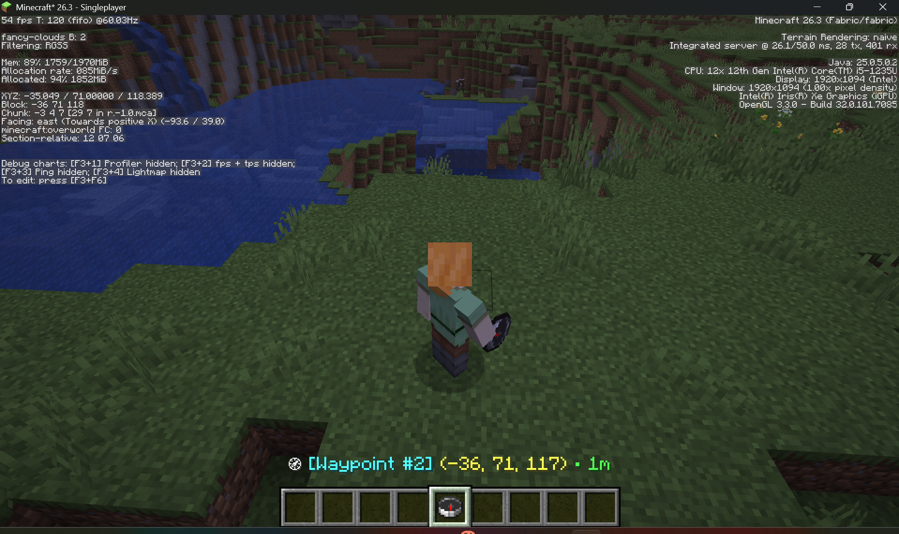
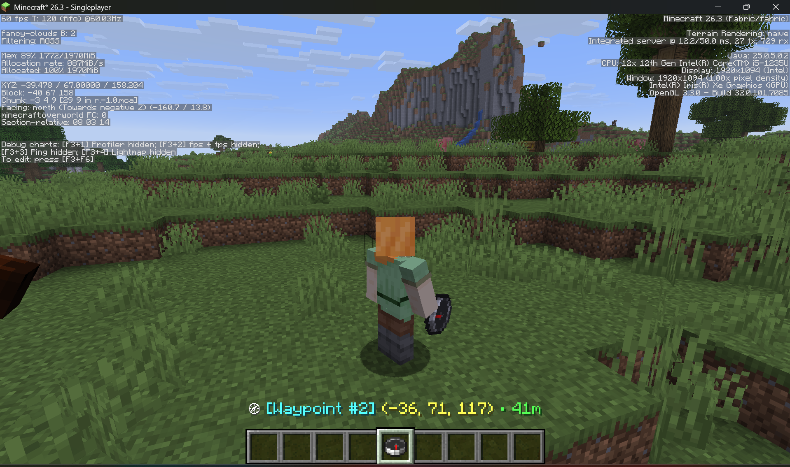
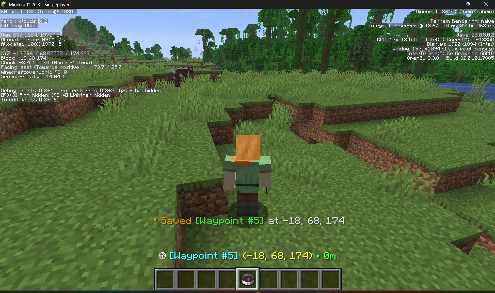
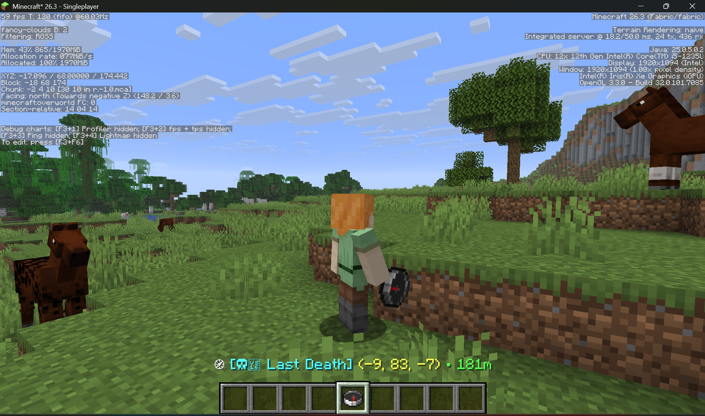
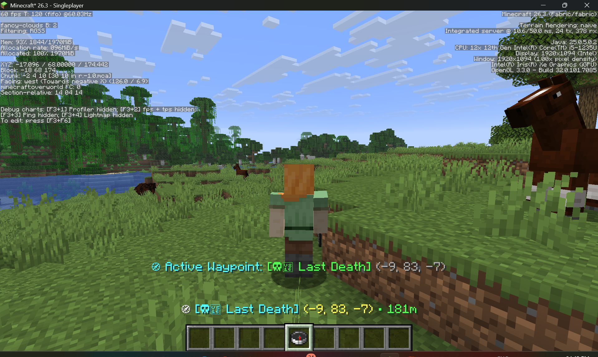
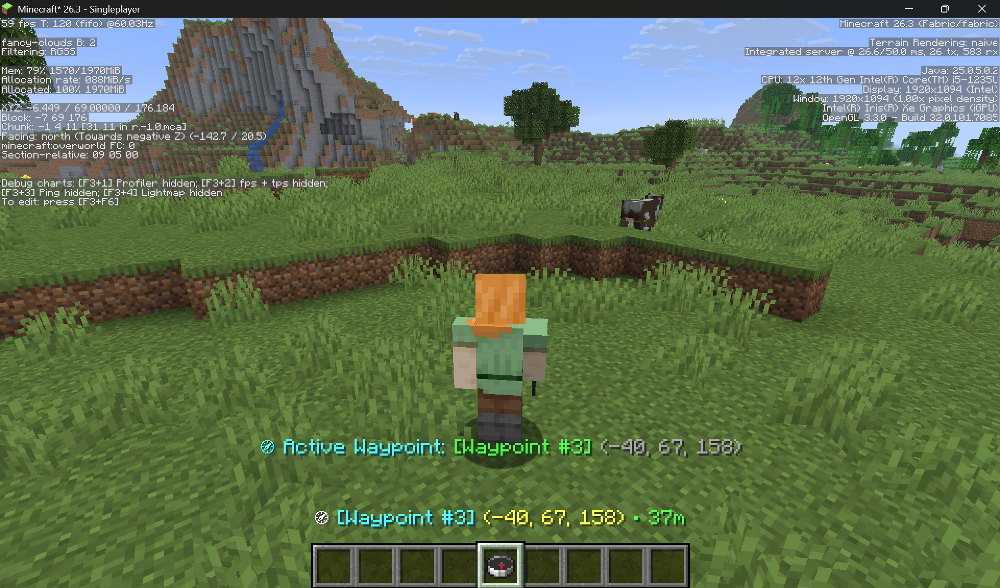

# 🧭 Waypoint Compass

[](https://modrinth.com/organization/1111w)
[](https://fabricmc.net/)
[](https://adoptium.net/)
[](LICENSE)
[](https://github.com/1111w-studio)

A lightweight, vanilla-friendly navigation mod for **Minecraft 26.3** running on **Fabric (Java 25)**.

Instead of heavy minimaps or immersion-breaking full-screen coordinate overlays, **Waypoint Compass** gives you an intuitive in-world tool to mark, track, cycle, and navigate back to locations and death spots directly from your hotbar.

---

## 📸 In-Game Visual Walkthrough

### 1. Live HUD Waypoint Tracking
Hold the **Waypoint Compass** in your main hand or off-hand to activate the real-time HUD tracker positioned cleanly above your hotbar. It displays your target's name, precise coordinates, and distance.



---

### 2. Real-Time Dynamic Distance Calculation
As you travel across terrain, the distance meter (`• 41m`) updates continuously, giving you clear directional feedback on whether you are heading towards or away from your destination.



---

### 3. One-Click Waypoint Saving
Right-click anywhere in the world to instantly lock and save your current coordinates into your compass memory.



---

### 4. Death Location Auto-Save & Corpse Recovery
Never lose your gear again. When you respawn, your death location is automatically broadcasted in chat and added to your compass as **`[Last Death]`**. Simply follow the meter back to your items!



*Cycling back to your death coordinates with action-bar confirmation:*



---

### 5. Multi-Waypoint Cycling
Store up to **10 custom waypoints** (bases, nether portals, mines, villages). Press **`Shift + Right-Click`** to smoothly cycle between them at any time.



---

## 🛠️ Crafting Recipe

Crafted at a standard Crafting Table using **1 Vanilla Compass** surrounded by **4 Amethyst Shards**:

```text
       [ Amethyst Shard ]
[ Amethyst Shard ] [ Compass ] [ Amethyst Shard ]
       [ Amethyst Shard ]
```

---

## 🎮 Controls

| Action | Control | Result |
|---|---|---|
| **Save Location** | `Right-Click` | Saves current `(X, Y, Z)` position as a new waypoint |
| **Cycle Waypoints** | `Shift + Right-Click` | Cycles through all saved waypoints |
| **View Live Distance** | Hold in Main / Off-Hand | Displays live tracking coordinates and distance on the HUD |
| **Inspect Waypoint** | Hover in Inventory (`E`) | Displays active waypoint name, coordinates, and waypoint count |

---

## ⚙️ Configuration (`config/waypoint_compass.json`)

```json
{
  "maxWaypoints": 10,
  "saveDeathLocation": true,
  "showHudOverlay": true
}
```

* `maxWaypoints`: Maximum number of locations stored in each compass (default: `10`).
* `saveDeathLocation`: Automatically save coordinates upon player death (default: `true`).
* `showHudOverlay`: Toggle the persistent on-screen HUD tracker above the hotbar (default: `true`).

---

## 📦 Compatibility & Tech Stack

| Specification | Version |
|---|---|
| **Minecraft Version** | `26.3` |
| **Java Toolchain** | `Java 25 (LTS)` |
| **Mod Loader** | Fabric Loader `>=0.20.1` |
| **Fabric API** | `0.165.0+26.3` |
| **Environment** | Client & Server compatible |

---

## 🚀 Building from Source

```powershell
# Windows
.\gradlew.bat build

# Linux / macOS
./gradlew build
```

Compiled release JAR will be generated in: `build/libs/waypoint-compass-1.0.0.jar`.

---

## 📄 License
Licensed under [CC0-1.0](LICENSE). Part of the **1111w Studio** collection.
